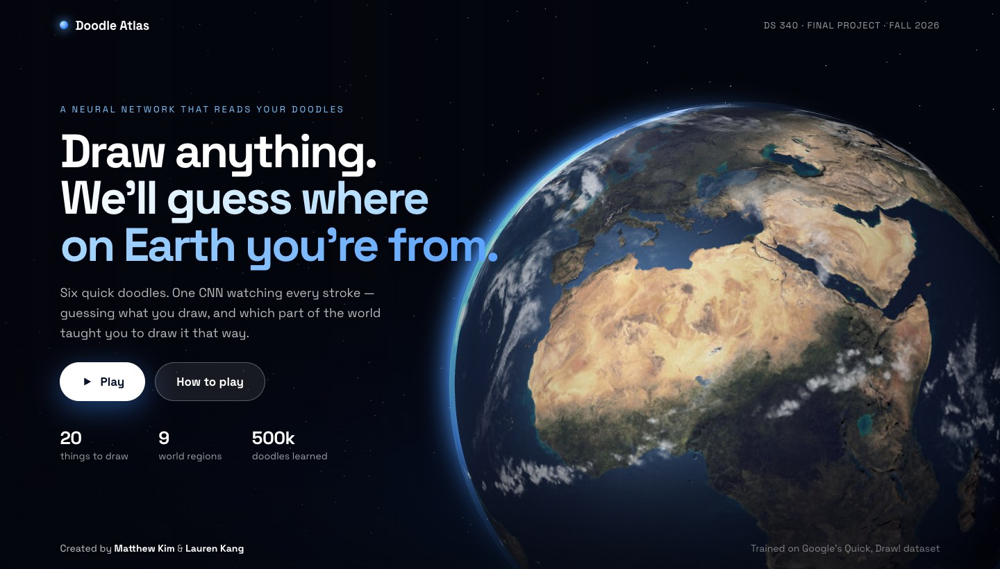
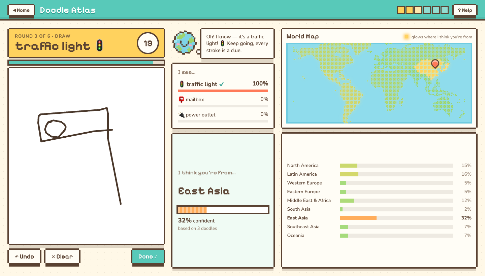
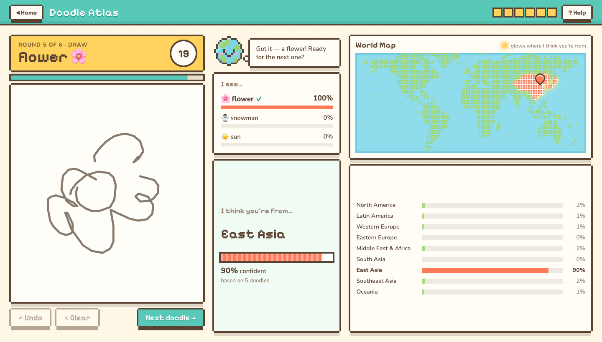
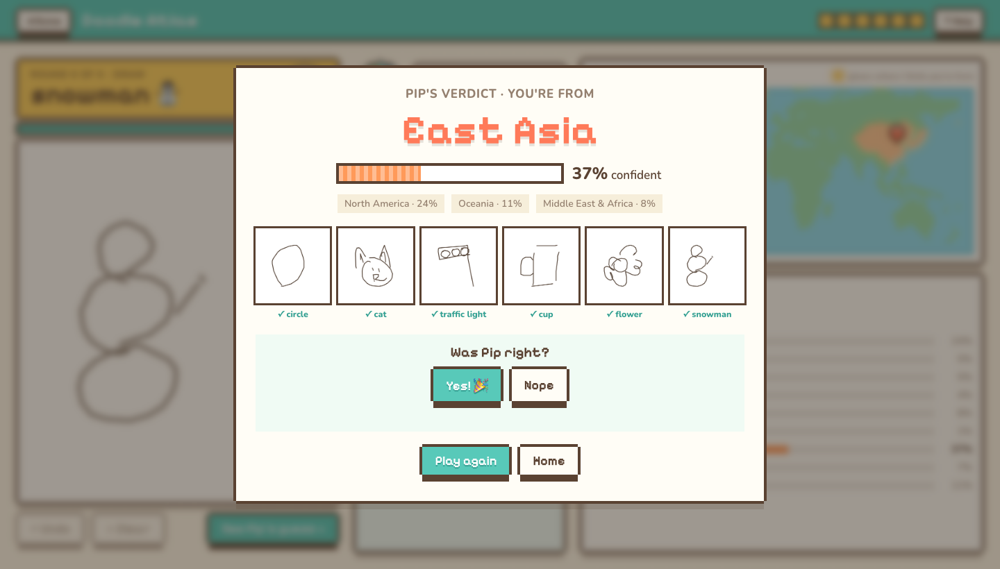
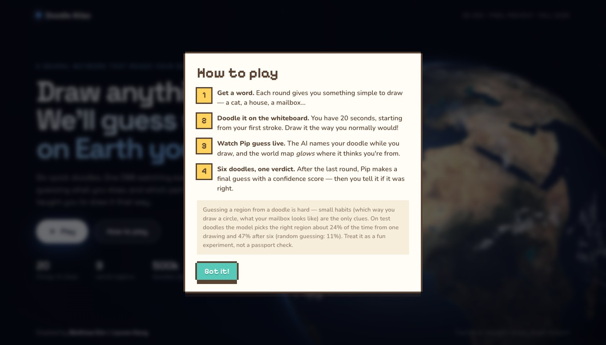

<div align="center">

# 🌍 Doodle Atlas ✏️

### Draw anything. We'll guess where on Earth you're from.

**DS 340 Final Project · Fall 2026 · Matthew Kim & Lauren Kang**




</div>

A drawing game where a neural network watches you doodle and guesses two things in real time:

1. 🎨 **What you're drawing** (like Google's Quick, Draw!)
2. 🗺️ **Which region of the world you're from**, with a confidence score — and a pixel-art world map that glows where the model thinks you live.

## 📸 A look at the game

| Guessing while you draw | The map heats up as Pip gets more sure |
|:---:|:---:|
|  |  |
| Halfway through a traffic light, Pip already knows what it is and has a first hunch about the region. | Five doodles in, East Asia glows coral and the confidence meter fills up. |

| Pip's final verdict | How to play |
|:---:|:---:|
|  |  |
| After six doodles: one guess, a confidence score, your gallery — and you tell Pip if it was right. | The in-game instructions, one click from the landing page. |

<sub>The doodles in these screenshots are real drawings by East Asian players from the Quick, Draw! test set (never seen in training), replayed stroke by stroke through the game. Confidence moves both ways: it hit 90% after five doodles and fell to 37% after the sixth.</sub>

## 📊 How good is it?

Measured on 50,732 test drawings the model never saw. With 9 regions, random guessing is 11%.

| | Result |
|---|---|
| Recognises the object (finished drawing) | **97.7%** |
| Right region from **one** doodle | **23.6%** (logistic regression baseline: 16.3%) |
| Right region from **six** doodles | **47%** — and in the top 3 guesses 79% of the time |
| Right region when the drawing is only half finished | 20.7% |

The six-doodle number uses simulated players (six different people from the same region, because the dataset has no player IDs), so a single real person may score lower. Full tables: [`results/RESULTS.md`](results/RESULTS.md).

---

## 🚀 1. Run the game (2 minutes)

You need Python 3.10 or newer. All commands are run **from this project folder**.

```bash
# one-time setup
python3 -m venv .venv
.venv/bin/pip install -r requirements.txt

# start the game
.venv/bin/python -m uvicorn server.app:app --port 8000
```

Then open **http://localhost:8000** in Chrome or Safari.

The trained model (`models/model.pt`) is included in the repo, so you do **not** need to download data or train anything just to play. Everything (fonts, 3D library, textures) is bundled — no internet needed during the demo.

To stop the server press `Ctrl + C` in the terminal.

> Windows: use `.venv\Scripts\pip` and `.venv\Scripts\python` instead of `.venv/bin/...`.

## 🎮 2. How to play

1. On the landing page press **Play** (or **How to play** for the in-game instructions).
2. Each round shows a word, e.g. **"Draw: snowman"**. Draw it on the white board with your mouse, trackpad or finger.
3. The **20-second timer** starts with your first stroke. Use **Undo** / **Clear** if you mess up, and **Done ✓** when you're finished (or just let the timer run out).
4. While you draw:
   - **"I see…"** lists the AI's top 3 guesses for *what* you're drawing.
   - **"I think you're from…"** shows its best guess for your region and how confident it is.
   - The **world map glows** — green means "probably not", yellow → coral means "more and more sure". The bars under the map show the percentage for all 9 regions.
5. After **6 doodles** Pip (the little globe) gives a final verdict that combines all six drawings. Tell it whether it was right — it keeps a score on your computer.

**The 9 regions:** North America · Latin America · Western Europe · Eastern Europe · Middle East & Africa · South Asia · East Asia · Southeast Asia · Oceania

**The 20 things you may be asked to draw:** circle, house, power outlet, chair, bread, mailbox, snowman, bus, cake, cup, traffic light, tree, sun, face, cat, star, fish, flower, car, door

## 🧠 3. How it works

```
your strokes ──► server renders a 3×64×64 image ──► CNN ──► category probabilities (20)
                                                        └─► region probabilities (9)
```

- **Data:** [Google Quick, Draw!](https://github.com/googlecreativelab/quickdraw-dataset) simplified NDJSON files. Every drawing has a country code; we map countries to 9 regions (`doodle/regions.py`) and keep up to 3,000 drawings per region per category → **507,316 drawings**, almost perfectly balanced across regions (South Asia has fewer drawings available).
- **Image encoding (`doodle/render.py`):** a normal bitmap forgets *how* you drew. We use 3 channels: (1) the ink, (2) drawing order — early ink is dim, late ink is bright, (3) stroke direction — each stroke fades from start to end. This lets the CNN see habits like which way you draw a circle.
- **Model (`doodle/model.py`):** one CNN (4 conv blocks: 32→64→128→256 filters, batch norm, max-pool, dropout) with two heads. The region head is also told which object is being drawn.
- **Partial drawings:** during training half of the drawings are cut off at a random point (15–100% finished), so the model can guess while you are still drawing.
- **Combining six doodles:** the game adds up the log-probabilities from each finished doodle (scaled by a calibration factor fitted on validation data) to get the overall belief shown on the map.

Measured results are in [`results/RESULTS.md`](results/RESULTS.md).

## 🔁 4. Rebuild everything from scratch (optional)

```bash
.venv/bin/python -m doodle.download      # streams ~2 GB from Google, keeps a 41 MB balanced sample in data/
.venv/bin/python -m doodle.train         # trains the main model -> models/model.pt   (about 1.5 hours on an 8 GB M3 MacBook)
.venv/bin/python -m doodle.evaluate      # test-set results -> results/RESULTS.md and results/metrics.json
```

Experiments from our proposal ("Variations"):

```bash
# training images: complete drawings only vs. partial + complete (default)
.venv/bin/python -m doodle.train --mode complete --name deep_complete
.venv/bin/python -m doodle.evaluate --name deep_complete

# model complexity: smaller CNN vs. deeper CNN (default)
.venv/bin/python -m doodle.train --arch small --name small_mixed
.venv/bin/python -m doodle.evaluate --name small_mixed
```

Per-category region accuracy is part of every `RESULTS*.md`.

The pixel world map (`web/assets/worldmap.json`) is generated by `scripts/build_world_map.py` from the public-domain Natural Earth country shapes.

## 🗂️ 5. Project layout

| Path | What it is |
|---|---|
| `doodle/config.py` | Categories, image size, paths |
| `doodle/regions.py` | Country code → region mapping |
| `doodle/download.py` | Streams Quick, Draw! and saves a region-balanced sample |
| `doodle/render.py` | Strokes → 3-channel image (used for training **and** the live game) |
| `doodle/data.py` | Dataset, train/val/test split, partial-drawing sampling |
| `doodle/model.py` | The CNN |
| `doodle/train.py`, `doodle/evaluate.py` | Training and evaluation |
| `server/app.py` | FastAPI server: serves the website, runs the model |
| `web/` | The game: `index.html`, `css/style.css`, `js/landing.js` (3D Earth), `js/game.js`, `js/map.js` |
| `models/model.pt` | Trained weights |
| `results/` | Training log, metrics, results tables |
| `docs/project_proposal.pdf` | Our proposal |
| `docs/screenshots/` | Screenshots used in this README |

## 🛠️ 6. Troubleshooting

- **"models/model.pt not found"** – run `python -m doodle.train` (after `python -m doodle.download`).
- **"Couldn't reach the game server"** – the page must be opened through `http://localhost:8000`, not by double-clicking `index.html`.
- **Port already in use** – use another port: `--port 8001`, then open `http://localhost:8001`.
- **The Earth doesn't show on the landing page** – your browser has WebGL turned off; the game still works.

## 🙏 7. Credits & honesty statement

- **Dataset:** Google Quick, Draw! (CC BY 4.0).
- **Earth textures & 3D library:** [three.js](https://threejs.org) (MIT) and its example planet textures, which are derived from NASA imagery.
- **Country shapes:** [Natural Earth](https://www.naturalearthdata.com) (public domain).
- **Fonts:** Space Grotesk, Pixelify Sans, Nunito (SIL Open Font License).
- **Inspiration:** Google's Quick, Draw! and [google_sketcher](https://github.com/elleryqueenhomels/google_sketcher). No code was copied from either.
- **AI assistance:** the code in this repository was written with Claude (Anthropic's Claude Code), directed by us, as disclosed in our proposal. See the git history for `Co-Authored-By` lines.
- **Limits:** a doodle carries only weak clues about where someone is from, the dataset has no player IDs, and "region" is a coarse grouping of countries. The guess is for fun and should not be used to make decisions about real people.
